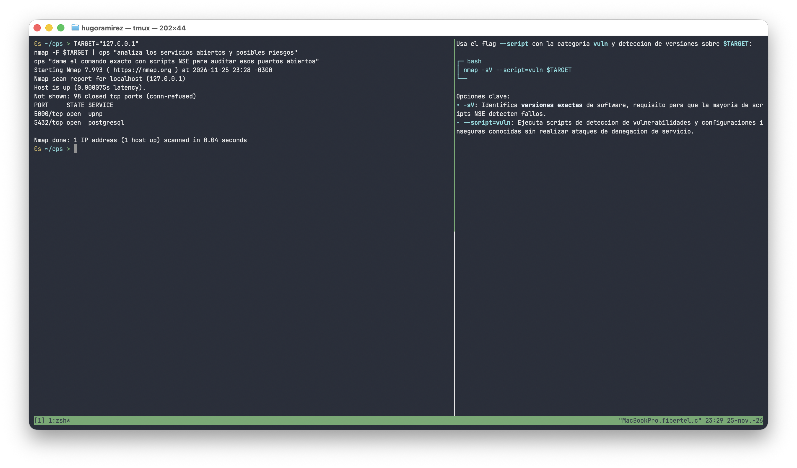

# OPS

Copiloto tactico de terminal para `tmux` escrito en Go. Permite enviar salidas de comandos mediante tuberias (`|`), redirecciones y consultas directas desde cualquier ventana de `tmux`, mostrando respuestas en tiempo real en un panel dedicado con historial y memoria de variables aislados por ventana.




## Caracteristicas

- **Integracion nativa con el shell:** Compatible con `|`, `2>&1`, `<`, `>` y `>>` manteniendo el comportamiento estandar de `stdout` en tu terminal de trabajo.
- **Memoria aislada por ventana:** Cada ventana de `tmux` conserva su propio historial de consultas, comandos recientes y variables definidas (`VAR=valor`).
- **Rastreo real de comandos:** Mediante un hook nativo de `zsh`, detecta los comandos ejecutados y variables creadas en el panel izquierdo sin necesidad de imprimirlos manualmente.
- **Perfiles de prompts y modelos:** Configurable desde `~/.config/ops/config.json` para alternar instrucciones y modelos sin modificar ni recompilar el codigo fuente.
- **Renderizado Markdown en terminal:** Formatea bloques de codigo, codigo en linea, negritas y listas usando secuencias ANSI mientras llegan los tokens.
- **Sin dependencias externas:** Compilado unicamente con la libreria estandar de Go.

---

## Requisitos

- Go 1.22 o superior
- `tmux`
- `zsh`
- Clave de API de Google Gemini

---

## Instalacion y configuracion inicial

### 1. Clonar y compilar el binario

Clona el repositorio y compila el ejecutable dentro de `~/.local/bin`:

```zsh
git clone <url-de-tu-repositorio> ops
cd ops
mkdir -p ~/.local/bin
go build -ldflags="-s -w" -o ~/.local/bin/ops ./cmd/ops
```

Los flags `-ldflags="-s -w"` eliminan la tabla de simbolos y la informacion de depuracion para reducir el tamano del binario final.

### 2. Agregar el binario al PATH y activar el hook en zsh

Para ejecutar `ops` desde cualquier directorio y permitir que registre los comandos y variables de cada panel, agrega estas dos lineas al final de tu `~/.zshrc`:

```zsh
export PATH="$HOME/.local/bin:$PATH"
eval "$(ops --hook)"
```

- **`export PATH=...`**: asegura que `zsh` encuentre el binario en `~/.local/bin` antes de evaluar cualquier otro comando.
- **`eval "$(ops --hook)"`**: carga la funcion interna `_ops_preexec` usando modulos nativos de `zsh` (`zsh/datetime`), registrando cada comando ejecutado en `/tmp/ops_tmux/` sin abrir subprocesos adicionales.

Aplica los cambios en tu sesion actual:

```zsh
source ~/.zshrc
which ops
```

### 3. Guardar la clave de API de forma segura

`ops` busca la clave en `~/.config/ops/credentials` antes de revisar variables de entorno. Guardarla en un archivo privado evita exponerla en el codigo fuente o en el entorno global del shell.

Crea el directorio de configuracion y guarda tu clave con permisos restringidos unicamente a tu usuario:

```zsh
mkdir -p ~/.config/ops
chmod 700 ~/.config/ops
printf 'GEMINI_API_KEY=tu_clave_de_gemini_aqui\n' > ~/.config/ops/credentials
chmod 600 ~/.config/ops/credentials
```

- `chmod 700` bloquea el acceso al directorio para otros usuarios del sistema.
- `chmod 600` permite lectura y escritura exclusivamente al propietario del archivo.


## Guia de uso paso a paso

### Paso 1: Preparar el espacio de trabajo en tmux

Inicia una sesion de `tmux` y divide la pantalla verticalmente (`Ctrl+b %` o tu atajo configurado):

```zsh
tmux
```

### Paso 2: Iniciar el panel receptor (derecha)

En el panel derecho, ejecuta `ops` sin argumentos ni tuberias. El proceso quedara escuchando eventos a traves de un socket Unix (`/tmp/ops_tmux/ops.sock`):

```zsh
ops
```

### Paso 3: Operar desde el panel de trabajo (izquierda)

Desde el panel izquierdo (o desde cualquier otra ventana que abras en la misma sesion de `tmux`), envia informacion segun lo que necesites:

**Analizar la salida de un comando** (la salida sigue mostrandose normalmente en el panel izquierdo):

```zsh
ls -la | ops "hay algun archivo temporal o pesado en este directorio"
```

**Capturar errores de compilacion o ejecucion** (redirigiendo `stderr` hacia `stdout` con `2>&1`):

```zsh
go build ./... 2>&1 | ops "explica la causa del error y como corregirlo"
```

**Usar un perfil de prompt predefinido (`-p`):**

```zsh
cat servidor.log | ops -p register
```

**Combinar un perfil con una instruccion adicional:**

```zsh
cat servidor.log | ops -p register "enfocate unicamente en fallos de red"
```

**Guardar la respuesta generada por la IA en un archivo:**
Al usar `>` o `>>`, `ops` detecta la redireccion, omite la impresion del flujo crudo y escribe directamente la respuesta del modelo en el archivo:

```zsh
ls -la | ops "resume los archivos principales" >> nota_ops.txt
```

**Guardar la respuesta en archivo manteniendo la salida del comando en pantalla (`-a` / `-o`):**

```zsh
ps aux | ops -a procesos.txt "indica los 3 procesos con mayor consumo"
```

**Consulta directa sin tuberia (aprovechando variables y comandos previos):**

```zsh
TARGET="https://api.github.com"
ops "dame un comando curl para inspeccionar las cabeceras de $TARGET"
```

**Multiventana en tmux:**
Si creas una nueva ventana (`Ctrl+b c`), el panel derecho detecta el cambio de foco automaticamente y muestra un contexto limpio para esa ventana sin mezclar variables ni historial con las demas.

---

## Referencia de argumentos

| Argumento | Forma larga | Descripcion |
| :--- | :--- | :--- |
| `(sin argumentos)` | — | Inicia el monitor receptor en el panel actual de `tmux`. |
| `"<consulta>"` | — | Envia una pregunta o instruccion directa usando el historial de la ventana. |
| `-p <nombre>` | `--prompt <nombre>` | Selecciona un perfil definido en `~/.config/ops/config.json`. |
| `-l` | `--prompts` | Lista la ruta de configuracion, el modelo activo y los perfiles disponibles. |
| `-o <archivo>` | `--out <archivo>` | Guarda la respuesta de la IA en `<archivo>` sobrescribiendo su contenido. |
| `-a <archivo>` | `--append <archivo>` | Agrega la respuesta de la IA al final de `<archivo>`. |
| `-q` | `--quiet` | Evita reimprimir en el panel izquierdo la salida recibida por `stdin`. |
| `-c` | `--clear` | Borra el historial, comandos registrados y variables de la ventana actual. |
| `--hook` | — | Imprime el script de integracion `preexec` para `zsh`. |

### Inspeccionar perfiles cargados (`ops -l`)

Ejecuta `ops -l` para verificar que el archivo de configuracion sea valido y ver los identificadores disponibles para usar con `-p`:

```zsh
ops -l
```

Salida esperada:

```text
Configuracion: /Users/usuario/.config/ops/config.json
Modelo base:   gemini-3.8-flash (thinking_budget: 0)

Perfiles disponibles:
  (sin -p)     -> Prompt principal por defecto
  -p cmd        -> Solo comando
  -p debug      -> Diagnostico rapido
  -p register   -> Registro y resumen de logs
```

---

## Configuracion de prompts y modelos

La primera vez que ejecutas `ops` o `ops -l`, se genera automaticamente `~/.config/ops/config.json`. Podes editarlo con cualquier editor de texto para ajustar parametros o agregar tus propios perfiles sin recompilar el binario.

```json
{
  "default_model": "gemini-3.8-flash",
  "thinking_budget": 0,
  "temperature": 0.3,
  "max_tokens": 700,
  "default_prompt": "Sos OPS, un asistente tecnico de terminal UNIX/macOS/Linux en tmux...",
  "prompts": {
    "register": {
      "name": "Registro y resumen de logs",
      "model": "",
      "prompt": "Analiza registros y salidas de terminal sin usar emojis..."
    },
    "cmd": {
      "name": "Solo comando",
      "model": "",
      "prompt": "Devolve unicamente el comando o one-liner exacto de bash/zsh..."
    },
    "debug": {
      "name": "Diagnostico rapido",
      "model": "",
      "prompt": "Identifica la causa exacta del fallo en maximo 2 lineas..."
    }
  }
}
```

### Parametros principales

- **`default_model`**: Modelo de Gemini usado cuando no se especifica otro en el perfil ni en el entorno.
- **`thinking_budget`**: Presupuesto de tokens de razonamiento previo. En `0` prioriza velocidad de respuesta inmediata.
- **`temperature`**: Controla la variabilidad de las respuestas (valores bajos como `0.2` - `0.3` producen comandos mas deterministas).
- **`max_tokens`**: Limite maximo de tokens por respuesta para mantener la salida compacta en pantalla dividida.
- **`default_prompt`**: Instruccion del sistema aplicada siempre que ejecutes `ops` sin el flag `-p`.
- **`prompts`**: Diccionario de perfiles personalizados. Cada entrada acepta:
  - `name`: Descripcion corta mostrada al ejecutar `ops -l`.
  - `model`: Modelo especifico para ese perfil (si se deja vacio `""`, hereda `default_model`).
  - `prompt`: Instruccion del sistema que reemplaza a `default_prompt` cuando se invoca `-p <clave>`.

### Agregar un perfil personalizado

Para crear un perfil nuevo (por ejemplo `git` para redactar commits a partir de `git diff`), agrega una clave dentro de `"prompts"` en `~/.config/ops/config.json`:

```json
"git": {
  "name": "Mensaje de commit",
  "model": "",
  "prompt": "Genera un mensaje de commit corto en formato Conventional Commits basado en el diff recibido. Sin explicaciones."
}
```

Luego podes invocarlo directamente:

```zsh
git diff --cached | ops -p git
```

### Cambiar de modelo temporalmente

Para probar otro modelo en una consulta puntual sin editar `config.json`, define la variable `OPS_MODEL` antes del comando:


